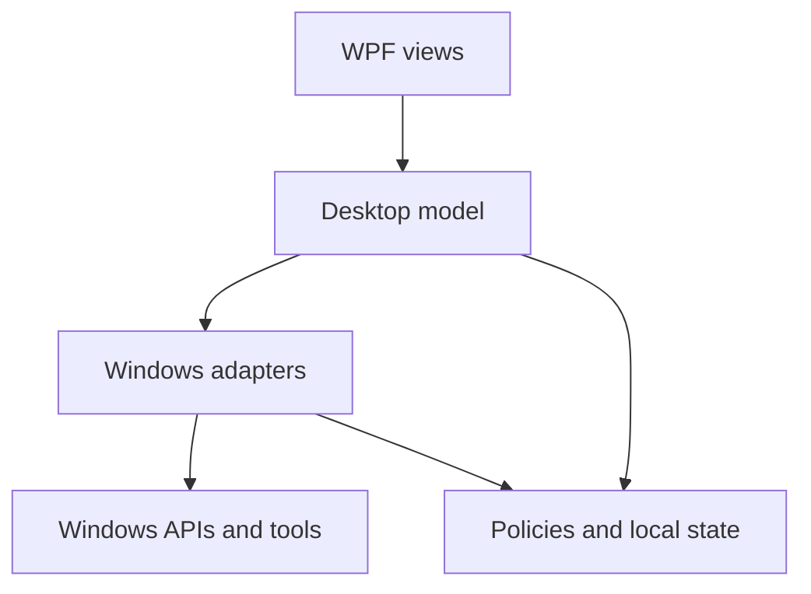

# Architecture

`AKASS.Optimizer.App` is the WPF executable. `MainWindow` assembles the views and manages interaction. `DesktopModel` holds view state and coordinates work. The composition root in `Program` constructs dependencies directly. `AKASS.Optimizer.Windows` contains Win32, COM, filesystem and Windows tool adapters. `AKASS.Optimizer.Core` owns thresholds, scoring, path policy, settings and activity storage. The console test project exercises Core and Windows adapters.

The UI uses asynchronous tasks for file scans, process enumeration and operations that can take time. Polling defaults to two seconds while a live page is visible, at least 12 seconds for opted-in background monitoring, and approximately eight seconds for process refreshes. A 75-sample in-memory buffer bounds the CPU and memory chart. Cleanup progress and cancellation flow through the desktop model. Manual and scheduled cleanup share a per-user mutex.

## Memory assessment

The reserve is 6% of visible physical RAM, bounded by 384 MiB and 2 GiB, then scaled by 0.8, 1, or 1.25 for the selected sensitivity. Critical means commit is at least 97%, or Windows reports low memory and available memory is below half the reserve. High means Windows reports low memory, or available RAM is below the reserve and either Windows memory load is at least 88% or commit is at least 85%. Elevated means free memory is below the reserve, commit is at least 80%, or memory load is at least 85% with less than twice the reserve available. Other valid samples are healthy. Sustained pressure reports the highest severity reached by at least three of the latest six valid samples.

## Maintenance score

| Factor | Weight | Calculation |
| --- | ---: | --- |
| Free space on the system drive | 40 | Linear from 0 points at 2% free to 40 points at 15% free. Values outside the range are clamped. |
| Sustained pressure | 35 | Healthy 35, elevated 28, high 14, critical 0. |
| Discovered active or registered startup items | 15 | One point deducted for every discovered active or registered item above six, up to a nine-point deduction. Registrations visible to the current account are a proxy for review effort. |
| Eligible cleanup opportunity | 10 | Six points when a scan finds 512 MiB or more in the standard categories. Otherwise ten points. |

The score omits missing factors and scales known points to 100. The live dashboard uses storage and sustained pressure. The on-demand report adds startup discovery and cleanup findings. This checklist score has no performance benchmark interpretation.
